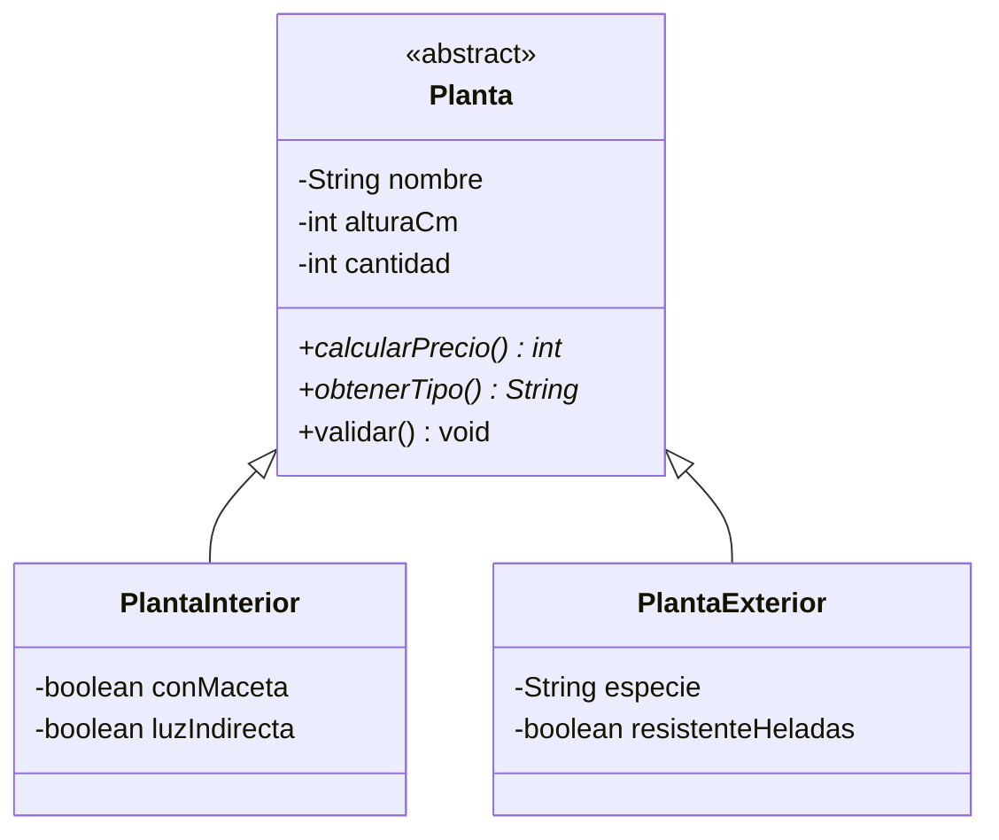

# Caso completo 04 · Vivero Hojas del Sur

**DSY1102 · Programación Orientada a Objetos · Caso de práctica**

> Material de práctica, similar a la tarea de la Fonda San Belarmino. La guía de resolución y la implementación de referencia están en la rama `solucion` (`GUIA.md` en esta carpeta).

| | |
|---|---|
| **Indicadores** | IL 2.1 al IL 2.8 |
| **Tiempo estimado** | 3 a 4 bloques |
| **Tecnologías** | Java 21 · Maven · JavaFX 21 · FXML / Scene Builder · Gson |
| **Temas** | Herencia, clases abstractas, MVC, `TableView`, filtro en tiempo real, ventana secundaria modal, validación dentro del formulario, Repository + DAO, JSON con Gson (un archivo por tipo), módulos |

---

## 1. Contexto

**Vivero Hojas del Sur** vende plantas de interior y de exterior. Hoy el stock se anota en una planilla. El modelo de negocio ya está programado y funciona por consola (`Main`). Se necesita una **aplicación de escritorio con ventanas** que permita a la persona encargada:

- ver las plantas registradas en una tabla y buscarlas por nombre;
- registrar plantas en un formulario que no acepte datos incompletos o inválidos;
- eliminar una planta del registro;
- conservar la información entre jornadas en archivos **JSON**.

## 2. Reglas del negocio (ya implementadas en `model/`)

| Concepto | Regla |
|---|---|
| Nombre | No puede ser nulo, vacío ni contener solo espacios. |
| Altura | Número entero entre 1 y 300 cm. |
| Cantidad en stock | Número entero entre 1 y 500 unidades. |
| **Planta de interior** | Precio unitario base de **$8.000**. Si se vende con maceta decorativa, el precio sube un **35 %**. Además indica si requiere luz indirecta (no cambia el precio). |
| **Planta de exterior** | Precio unitario base de **$5.500**. Si resiste las heladas, el precio sube un **20 %**. Tiene una especie (obligatoria). |

Si un dato no cumple, el modelo lo rechaza con una `IllegalArgumentException` cuyo mensaje explica el motivo. Los nombres pueden repetirse.



`validar()` vuelve a comprobar todas las reglas sobre los datos actuales. Se necesita porque Gson llena los atributos directamente, **sin pasar por el constructor ni por los *setters***.

## 3. Arquitectura esperada

| Paquete | Contenido | Responsabilidad |
|---|---|---|
| `cl.dsy1102.vivero` | `AppFX`, `Main` | Arranque, ciclo de vida y armado de las capas. |
| `...model` | Resuelto | Datos y reglas del negocio. |
| `...dao` | `PlantaDao<T>`, `GsonPlantaDao<T>`, `PersistenciaException` | Leer y escribir un JSON. Única capa que conoce el formato. |
| `...repository` | `Repository<T>`, `PlantaRepository` | `ObservableList` + operaciones que persisten en cada cambio. |
| `...controller` | `PrincipalController`, `FormularioController` | Leer campos, validar, mostrar mensajes y delegar. |
| `resources/.../view` | `principal-view.fxml`, `formulario-view.fxml`, `styles.css` | Estructura visual. |

---

## 4. Requerimientos

### R1. Proyecto y ciclo de vida
- El `pom.xml` y el `module-info.java` ya están configurados. Revisa para qué sirve cada dependencia y cada `opens` (¿por qué el modelo se abre a `com.google.gson` **y** a `javafx.base`?).
- `AppFX` traza por consola `init()`, `start()` y `stop()` y usa el `Stage` que recibe `start()`.

### R2. Ventana principal
- `TableView` con las columnas **Tipo, Nombre, Altura (cm), Cantidad y Precio unitario**. El precio lo calcula el modelo y se muestra como `$10.800`; al ordenar por esa columna debe ordenar por valor.
- Campo de búsqueda por nombre: mientras se escribe, la tabla muestra solo las plantas cuyo nombre **contiene** el texto, sin distinguir mayúsculas de minúsculas. Al borrar el texto vuelven todas. Buscar **no** elimina ni modifica los datos.
- Botón **Agregar**, que abre la ventana de registro (R3).
- Botón **Eliminar**, que quita la planta seleccionada. Sin una fila seleccionada informa que debe seleccionar una planta y no cambia nada.
- Un **área de mensajes dentro de la misma ventana** donde se informa el resultado de cada acción: registro correcto, eliminación, falta de selección y errores al leer o guardar los archivos. **Cada mensaje reemplaza al anterior.** Los mensajes no se muestran por consola ni en ventanas de diálogo (`Alert`).

### R3. Ventana de registro
- Se abre desde el controlador de la ventana principal como una **segunda ventana modal**: mientras está abierta no se puede usar la principal.
- Contiene un selector de **tipo** (Interior / Exterior), los datos comunes (nombre, altura, cantidad) y los específicos del tipo elegido: interior (con maceta, requiere luz indirecta) o exterior (especie, resiste heladas). Al cambiar el tipo, solo quedan visibles los datos de ese tipo.
- Dos botones: **Confirmar** (valida y, si todo está correcto, registra, cierra la ventana y deja el mensaje en la principal) y **Cancelar** (cierra sin registrar nada).

### R4. Validaciones del formulario
- Tipo seleccionado; nombre no vacío ni solo espacios; altura y cantidad enteras dentro de sus rangos; especie no vacía (solo exterior).
- Si algún dato no es válido: la planta **no** se registra, **el propio formulario** indica qué campo es incorrecto y por qué, **los valores ingresados se mantienen** para corregirlos y la aplicación no se detiene ni escribe errores en la consola.

### R5. Persistencia con Gson (un archivo por tipo)
- Carpeta `data/`: `interiores.json` con las plantas de interior y `exteriores.json` con las de exterior. **Solo `AppFX` y el DAO conocen esas rutas.**
- Al iniciar se cargan ambos archivos y se muestran en la tabla. Cada registro o eliminación actualiza **automáticamente** el archivo del tipo afectado, sin botón de guardar. Lo que muestra la tabla y lo guardado deben coincidir siempre.

| Situación | Comportamiento esperado |
|---|---|
| El archivo no existe | Tabla vacía, sin error. |
| El archivo está vacío | Tabla vacía, sin error (ojo: Gson retorna `null`). |
| La carpeta `data/` no existe | Se crea al guardar. |
| Archivo dañado o con datos que el modelo rechaza | `PersistenciaException` → mensaje en la ventana principal; la aplicación sigue con la tabla vacía. |
| No se puede escribir | `PersistenciaException` → mensaje en la ventana principal. **La tabla no muestra un cambio que no se guardó.** |

### R6. Repository + DAO
- `PlantaDao<T>` y una implementación genérica `GsonPlantaDao<T>`: se crea una por tipo de planta.
- `Repository<T>` y `PlantaRepository`: mantienen la `ObservableList` que se enlaza a la tabla y guardan después de cada cambio. Ningún controlador conoce `File`, `Path`, `Gson` ni los nombres de los archivos.
- Los cambios se hacen sobre la `ObservableList`, nunca sobre las filas de la tabla.

### R7. Estabilidad
- Ninguna acción lanza excepciones a la consola; ningún controlador captura `IOException`.
- Cerrar y volver a abrir la aplicación muestra las mismas plantas.

---

## 5. Datos de prueba

| Tipo | Nombre | Altura | Cantidad | Específico | Precio unitario |
|---|---|---|---|---|---|
| Interior | Helecho | 40 | 12 | Con maceta · luz indirecta | $10.800 |
| Interior | Cactus | 15 | 30 | Sin maceta | $8.000 |
| Exterior | Lavanda | 60 | 25 | *Lavandula angustifolia* · resiste heladas | $6.600 |
| Exterior | Rosal | 90 | 8 | *Rosa x hybrida* · no resiste heladas | $5.500 |

Pruebas que usará quien revise:

1. Pulsar **Eliminar** sin seleccionar una fila: el aviso aparece en la misma ventana.
2. Registrar las cuatro plantas. Escribir `lav` en el buscador (solo Lavanda) y luego borrarlo (vuelven las cuatro).
3. En el formulario: altura `abc`, cantidad `0` y nombre vacío → el formulario indica cada campo y motivo, conserva lo escrito y no se cierra. **Cancelar** no registra nada.
4. Con la ventana de registro abierta, intentar usar la principal: no responde.
5. Eliminar Rosal, cerrar y abrir la aplicación: no aparece. Revisar que `interiores.json` y `exteriores.json` reflejan la tabla.
6. Borrar la carpeta `data/` → la aplicación inicia vacía. Escribir texto inválido en `interiores.json` → mensaje en la ventana, sin cierre.

## 6. Cómo ejecutar

```bash
mvn compile exec:java    # demostración del modelo por consola
mvn javafx:run           # aplicación gráfica
```

## 7. Autoevaluación

| Dimensión | Pregunta de control |
|---|---|
| Estabilidad | ¿La aplicación abre y cierra ambas ventanas sin excepciones en consola? |
| Cohesión | ¿Los controladores solo tienen lógica de interfaz y delegan en el repositorio y el modelo? |
| Usabilidad y validación | ¿El formulario informa qué campo corregir, por qué, y conserva lo escrito? ¿Todos los mensajes aparecen donde corresponde? |
| Persistencia | ¿Cada tipo se guarda en su archivo? ¿Un archivo vacío o dañado se maneja sin caerse? |
| Control de versiones | ¿El historial muestra commits por capa? |
